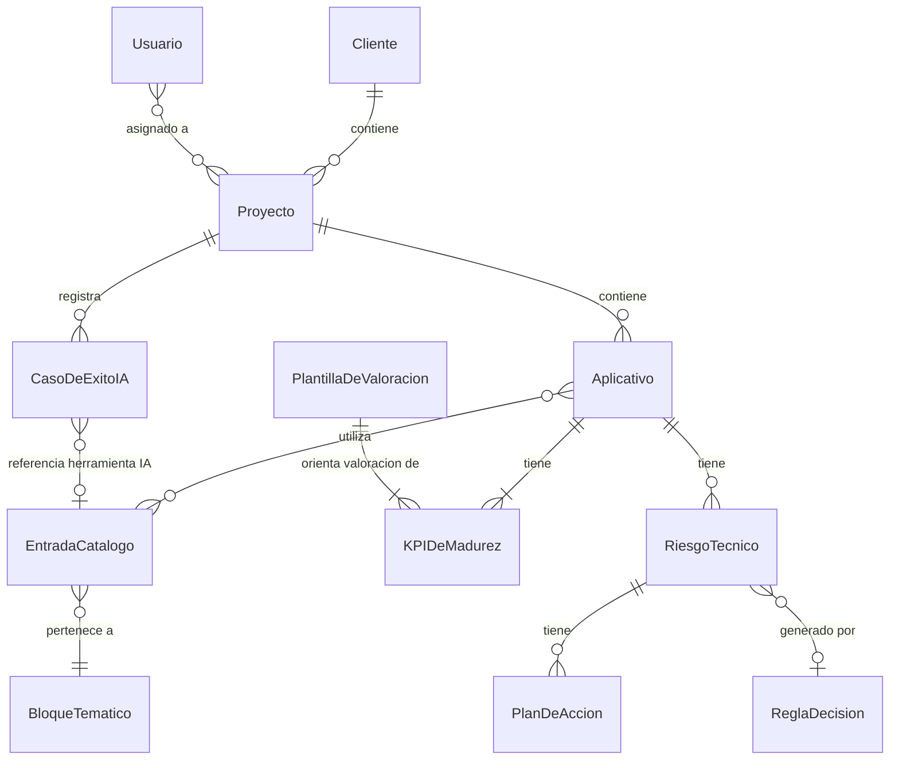
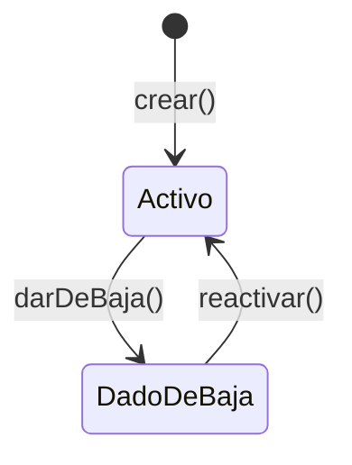
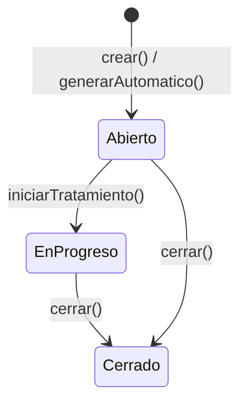
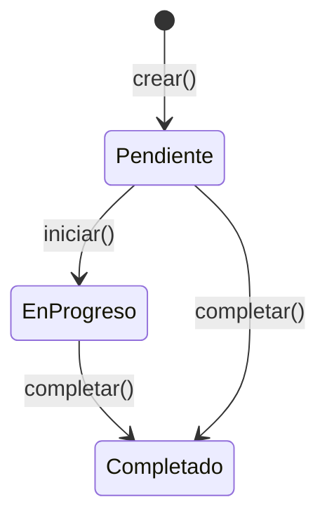
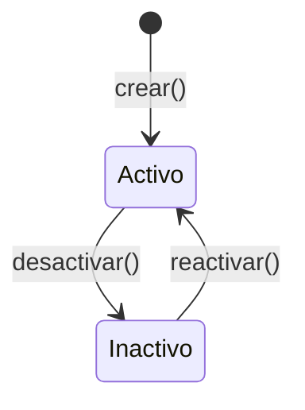

# [DOM-001] Modelo de Dominio Funcional — Project Monitor

## 1. Visión general de entidades

El dominio de Project Monitor se organiza en torno a tres grandes áreas funcionales:

- **Jerarquía organizativa:** Cliente → Proyecto → Aplicativo — la estructura de referencia sobre la que se registra toda la información del sistema.
- **Catálogo tecnológico:** BloqueTematico y EntradaCatalogo — el referencial de tecnologías, herramientas e infraestructuras gestionado por el Administrador.
- **Capa de madurez y riesgo:** KPIDeMadurez, PlantillaDeValoracion, ReglaDecision, RiesgoTecnico, PlanDeAccion, CasoDeExitoIA — los objetos que capturan, miden y actúan sobre la madurez técnica de los aplicativos.

La entidad transversal **Usuario** representa a los actores humanos identificados en [ACT-001], y sus asignaciones a proyectos delimitan el alcance operativo de cada rol.

---

## 2. Entidades

### [ENT-001] Cliente

**Descripción:** Nivel superior de la jerarquía organizativa de la DT; representa la organización interna o externa para la que la DT desarrolla o mantiene uno o más proyectos. Gestionado exclusivamente por el Administrador.

**Término del glosario:** [GLO-T008]

#### Atributos

| Atributo | Tipo lógico | Obligatorio | Restricción | Descripción |
|----------|-------------|-------------|-------------|-------------|
| id | Identificador | Sí | Único, auto-generado | Identificador único del cliente |
| nombre | Texto | Sí | Máx. 200 caracteres, no vacío | Nombre del cliente |
| descripcion | Texto | No | Máx. 2000 caracteres | Descripción del cliente |
| fechaCreacion | FechaHora | Sí | Auto-asignada en creación | Fecha y hora de creación del registro |
| fechaModificacion | FechaHora | Sí | Auto-actualizada en cada cambio | Fecha y hora de la última modificación |

#### Relaciones

| Entidad relacionada | Cardinalidad | Descripción de la relación |
|---------------------|--------------|---------------------------|
| [ENT-002] Proyecto | 1 → N | Un Cliente contiene cero o varios Proyectos |

---

### [ENT-002] Proyecto

**Descripción:** Nivel intermedio de la jerarquía organizativa; agrupa uno o más aplicativos desarrollados o mantenidos bajo un mismo contrato o iniciativa para un cliente determinado. Gestionado por el Administrador; supervisado por el Manager.

**Término del glosario:** [GLO-T022]

#### Atributos

| Atributo | Tipo lógico | Obligatorio | Restricción | Descripción |
|----------|-------------|-------------|-------------|-------------|
| id | Identificador | Sí | Único, auto-generado | Identificador único del proyecto |
| nombre | Texto | Sí | Máx. 200 caracteres, no vacío | Nombre del proyecto |
| descripcion | Texto | No | Máx. 2000 caracteres | Descripción del proyecto |
| clienteId | Identificador | Sí | FK a Cliente | Referencia al cliente propietario |
| fechaCreacion | FechaHora | Sí | Auto-asignada en creación | Fecha y hora de creación del registro |
| fechaModificacion | FechaHora | Sí | Auto-actualizada en cada cambio | Fecha y hora de la última modificación |

#### Relaciones

| Entidad relacionada | Cardinalidad | Descripción de la relación |
|---------------------|--------------|---------------------------|
| [ENT-001] Cliente | N → 1 | Un Proyecto pertenece a exactamente un Cliente |
| [ENT-003] Aplicativo | 1 → N | Un Proyecto contiene cero o varios Aplicativos |
| [ENT-010] CasoDeExitoIA | 1 → N | Un Proyecto puede tener registrados cero o varios casos de éxito de IA |
| [ENT-012] Usuario | N → N | Un Proyecto tiene asignados uno o varios Usuarios (Managers y Referentes DT) en el alcance de su rol |

---

### [ENT-003] Aplicativo

**Descripción:** Unidad mínima de la jerarquía organizativa; representa un sistema o componente de software gestionado bajo un proyecto específico y asociado a entradas del catálogo tecnológico. Es la entidad sobre la que se registran los KPIs de madurez y los riesgos técnicos.

**Término del glosario:** [GLO-T002]

#### Atributos

| Atributo | Tipo lógico | Obligatorio | Restricción | Descripción |
|----------|-------------|-------------|-------------|-------------|
| id | Identificador | Sí | Único, auto-generado | Identificador único del aplicativo |
| nombre | Texto | Sí | Máx. 200 caracteres, no vacío | Nombre del aplicativo |
| descripcion | Texto | No | Máx. 2000 caracteres | Descripción del aplicativo |
| proyectoId | Identificador | Sí | FK a Proyecto | Referencia al proyecto propietario |
| fechaCreacion | FechaHora | Sí | Auto-asignada en creación | Fecha y hora de creación del registro |
| fechaModificacion | FechaHora | Sí | Auto-actualizada en cada cambio | Fecha y hora de la última modificación |

#### Relaciones

| Entidad relacionada | Cardinalidad | Descripción de la relación |
|---------------------|--------------|---------------------------|
| [ENT-002] Proyecto | N → 1 | Un Aplicativo pertenece a exactamente un Proyecto |
| [ENT-004] EntradaCatalogo | N → N | Un Aplicativo utiliza cero o varias EntradaCatalogo (stack tecnológico, entornos, herramientas CI/CD, etc.) |
| [ENT-006] KPIDeMadurez | 1 → 7 | Un Aplicativo tiene exactamente 7 registros KPIDeMadurez, uno por cada DimensiónDeMadurez |
| [ENT-008] RiesgoTecnico | 1 → N | Un Aplicativo puede tener cero o varios RiesgosTecnicos asociados |

> **Nota:** Al crear un Aplicativo, el sistema genera automáticamente 7 registros KPIDeMadurez con valor nulo (ver BR-TRG-D005).

---

### [ENT-004] EntradaCatalogo

**Descripción:** Elemento del catálogo tecnológico que representa una tecnología, herramienta, entorno de infraestructura, puesto de trabajo o herramienta de IA utilizada en los proyectos de la DT. Cada entrada pertenece a un BloqueTematico y puede estar en estado activo o dado de baja. Gestionado exclusivamente por el Administrador.

**Término del glosario:** [GLO-T007] (repositorio), [GLO-T012] (entorno), [GLO-T015] (herramienta de IA), [GLO-T025] (puesto de trabajo), [GLO-T030] (stack tecnológico)

#### Atributos

| Atributo | Tipo lógico | Obligatorio | Restricción | Descripción |
|----------|-------------|-------------|-------------|-------------|
| id | Identificador | Sí | Único, auto-generado | Identificador único de la entrada |
| nombre | Texto | Sí | Máx. 200 caracteres, no vacío | Nombre de la tecnología o herramienta |
| descripcion | Texto | No | Máx. 500 caracteres | Descripción de la entrada del catálogo |
| bloqueTematicoId | Identificador | Sí | FK a BloqueTematico | Bloque temático al que pertenece la entrada |
| tipoPropiedad | Enum:TipoDePropiedad | Sí | Ver REF-003 | Nivel organizativo que gestiona la herramienta: corporativo, proyecto o cliente |
| estado | Enum:EstadoEntradaCatalogo | Sí | Ver REF-002; valor por defecto: activo | Estado actual de la entrada en el catálogo |
| fechaCreacion | FechaHora | Sí | Auto-asignada en creación | Fecha y hora de creación del registro |
| fechaModificacion | FechaHora | Sí | Auto-actualizada en cada cambio | Fecha y hora de la última modificación |

#### Relaciones

| Entidad relacionada | Cardinalidad | Descripción de la relación |
|---------------------|--------------|---------------------------|
| [ENT-005] BloqueTematico | N → 1 | Una EntradaCatalogo pertenece a exactamente un BloqueTematico |
| [ENT-003] Aplicativo | N → N | Una EntradaCatalogo puede ser utilizada por cero o varios Aplicativos |
| [ENT-010] CasoDeExitoIA | 1 → N | Una EntradaCatalogo de tipo herramienta de IA puede ser referenciada por cero o varios CasosDeExitoIA (opcional) |

#### Ciclo de vida

| Transición | Estado origen | Estado destino | Condición | Acción desencadenada |
|------------|---------------|----------------|-----------|----------------------|
| crear | — | Activo | Campos obligatorios cumplimentados | Entrada disponible para asociar a Aplicativos |
| darDeBaja | Activo | DadoDeBaja | Acción del Administrador | Notificación interna a Referentes DT y Managers con Aplicativos asociados (pendiente de especificación — ESC-002 de [ACT-001]) |
| reactivar | DadoDeBaja | Activo | Acción del Administrador | Entrada nuevamente disponible para asociar a Aplicativos |

---

### [ENT-005] BloqueTematico

**Descripción:** Agrupación de entradas del catálogo tecnológico que pertenecen a una misma categoría funcional (stack tecnológico, entorno de desarrollo, entornos de infraestructura, industrialización CI/CD, calidad y seguridad, inteligencia artificial, puestos de trabajo). Gestionado por el Administrador.

**Término del glosario:** [GLO-T004]

#### Atributos

| Atributo | Tipo lógico | Obligatorio | Restricción | Descripción |
|----------|-------------|-------------|-------------|-------------|
| id | Identificador | Sí | Único, auto-generado | Identificador único del bloque |
| nombre | Texto | Sí | Máx. 100 caracteres, único en el sistema | Nombre del bloque temático |
| descripcion | Texto | No | Máx. 500 caracteres | Descripción del bloque temático |
| orden | Entero | Sí | ≥ 1, único por posición | Orden de presentación en la interfaz |

#### Relaciones

| Entidad relacionada | Cardinalidad | Descripción de la relación |
|---------------------|--------------|---------------------------|
| [ENT-004] EntradaCatalogo | 1 → N | Un BloqueTematico contiene una o varias EntradaCatalogo |

---

### [ENT-006] KPIDeMadurez

**Descripción:** Indicador numérico en escala 1 a 10 que cuantifica el nivel de adopción y excelencia de una práctica técnica concreta en un Aplicativo, para una DimensiónDeMadurez específica. El valor es nulo si el Aplicativo no ha sido evaluado en esa dimensión. Introducido manualmente por el Referente DT en el MVP.

**Término del glosario:** [GLO-T017]

#### Atributos

| Atributo | Tipo lógico | Obligatorio | Restricción | Descripción |
|----------|-------------|-------------|-------------|-------------|
| id | Identificador | Sí | Único, auto-generado | Identificador único del KPI |
| aplicativoId | Identificador | Sí | FK a Aplicativo | Aplicativo al que pertenece el KPI |
| dimension | Enum:DimensionDeMadurez | Sí | Ver REF-001; único por Aplicativo + Dimension | Dimensión de madurez que mide este KPI |
| valor | Entero | No | 1-10 inclusive, o nulo si no evaluado | Puntuación del KPI en la dimensión |
| fechaEvaluacion | Fecha | Condicional | Obligatorio si valor no es nulo | Fecha en que se realizó la evaluación |
| justificacion | Texto | Condicional | Obligatorio si valor no es nulo; máx. 2000 caracteres | Justificación textual de la puntuación asignada |
| datosBrutos | Texto | No | Máx. 2000 caracteres | Datos brutos opcionales que respaldan la puntuación |
| plantillaVersion | Texto | No | Versión de PlantillaDeValoracion usada | Referencia informativa a la versión de la guía aplicada |

#### Relaciones

| Entidad relacionada | Cardinalidad | Descripción de la relación |
|---------------------|--------------|---------------------------|
| [ENT-003] Aplicativo | N → 1 | Un KPIDeMadurez pertenece a exactamente un Aplicativo |
| [ENT-007] PlantillaDeValoracion | N → 1 | Un KPIDeMadurez está orientado por la PlantillaDeValoracion de su dimensión |

> **Nota:** La combinación (aplicativoId, dimension) es única: existe exactamente un KPIDeMadurez por Aplicativo y por DimensiónDeMadurez.

---

### [ENT-007] PlantillaDeValoracion

**Descripción:** Guía de referencia que define los criterios objetivos y ejemplos concretos que justifican cada nivel de puntuación (1-10) para una DimensiónDeMadurez específica. Sirve de referencia al Referente DT cuando introduce un KPI. Administrada por el Administrador.

**Término del glosario:** [GLO-T021]

#### Atributos

| Atributo | Tipo lógico | Obligatorio | Restricción | Descripción |
|----------|-------------|-------------|-------------|-------------|
| id | Identificador | Sí | Único, auto-generado | Identificador único de la plantilla |
| dimension | Enum:DimensionDeMadurez | Sí | Ver REF-001; único cuando activa=true | Dimensión de madurez a la que corresponde la plantilla |
| version | Texto | Sí | Formato libre, máx. 20 caracteres | Número de versión de la plantilla |
| contenido | Texto | Sí | Texto estructurado con criterios por nivel | Criterios y ejemplos para cada puntuación del 1 al 10 |
| activa | Booleano | Sí | Solo una plantilla activa por dimensión simultáneamente | Indica si la plantilla es la versión vigente para la dimensión |
| fechaModificacion | FechaHora | Sí | Auto-actualizada en cada cambio | Fecha y hora de la última modificación |

#### Relaciones

| Entidad relacionada | Cardinalidad | Descripción de la relación |
|---------------------|--------------|---------------------------|
| [ENT-006] KPIDeMadurez | 1 → N | Una PlantillaDeValoracion activa orienta la valoración de todos los KPIDeMadurez de su dimensión |

---

### [ENT-008] RiesgoTecnico

**Descripción:** Situación identificada en un Aplicativo que puede comprometer la calidad, la seguridad o la continuidad del servicio. Puede generarse automáticamente cuando los KPIs de un Aplicativo incumplen las ReglaDecision activas, o registrarse manualmente por el Referente DT o el Manager.

**Término del glosario:** [GLO-T028]

#### Atributos

| Atributo | Tipo lógico | Obligatorio | Restricción | Descripción |
|----------|-------------|-------------|-------------|-------------|
| id | Identificador | Sí | Único, auto-generado | Identificador único del riesgo |
| titulo | Texto | Sí | Máx. 200 caracteres, no vacío | Título descriptivo del riesgo técnico |
| descripcion | Texto | Sí | Máx. 2000 caracteres | Descripción detallada del riesgo identificado |
| tipo | Enum:TipoDeRiesgo | Sí | Ver REF-004 | Origen del riesgo: automático (generado por ReglaDecision) o manual (registrado por usuario) |
| estado | Enum:EstadoDeRiesgo | Sí | Ver REF-005; valor por defecto: abierto | Estado actual del riesgo |
| aplicativoId | Identificador | Sí | FK a Aplicativo | Aplicativo al que está asociado el riesgo |
| reglaDecisionId | Identificador | No | FK a ReglaDecision; obligatorio si tipo=automatico | ReglaDecision que generó el riesgo (solo para riesgos automáticos) |
| creadoPor | Identificador | Sí | FK a Usuario | Usuario que creó el registro |
| fechaCreacion | FechaHora | Sí | Auto-asignada en creación | Fecha y hora de creación del riesgo |
| fechaCierre | Fecha | Condicional | Obligatorio si estado=cerrado | Fecha de cierre o resolución del riesgo |

#### Relaciones

| Entidad relacionada | Cardinalidad | Descripción de la relación |
|---------------------|--------------|---------------------------|
| [ENT-003] Aplicativo | N → 1 | Un RiesgoTecnico está asociado a exactamente un Aplicativo |
| [ENT-009] PlanDeAccion | 1 → N | Un RiesgoTecnico puede tener cero o varios PlanesDeAccion asociados |
| [ENT-011] ReglaDecision | N → 0..1 | Un RiesgoTecnico automático está generado por exactamente una ReglaDecision; un riesgo manual no tiene ReglaDecision asociada |

#### Ciclo de vida

| Transición | Estado origen | Estado destino | Condición | Acción desencadenada |
|------------|---------------|----------------|-----------|----------------------|
| crear | — | Abierto | Usuario registra riesgo manual con campos obligatorios | Riesgo disponible para asociar PlanesDeAccion |
| generarAutomatico | — | Abierto | ReglaDecision activa detecta umbral incumplido | RiesgoTecnico creado automáticamente por el sistema |
| iniciarTratamiento | Abierto | EnProgreso | Al menos un PlanDeAccion asociado está activo | — |
| cerrar | Abierto / EnProgreso | Cerrado | Usuario cierra el riesgo con fecha de cierre | — |

---

### [ENT-009] PlanDeAccion

**Descripción:** Descripción de las medidas correctivas o preventivas asociadas a un RiesgoTecnico que especifica qué debe realizarse, por quién y en qué plazo para reducir o eliminar el riesgo identificado.

**Término del glosario:** [GLO-T020]

#### Atributos

| Atributo | Tipo lógico | Obligatorio | Restricción | Descripción |
|----------|-------------|-------------|-------------|-------------|
| id | Identificador | Sí | Único, auto-generado | Identificador único del plan de acción |
| descripcion | Texto | Sí | Máx. 2000 caracteres | Descripción de las medidas a tomar |
| responsable | Texto | Sí | Máx. 200 caracteres | Descripción del responsable de ejecutar el plan |
| plazo | Fecha | Sí | Posterior a la fecha de creación | Fecha límite para completar el plan de acción |
| estado | Enum:EstadoDePlanDeAccion | Sí | Ver REF-009; valor por defecto: pendiente | Estado actual del plan de acción |
| riesgoTecnicoId | Identificador | Sí | FK a RiesgoTecnico | RiesgoTecnico al que está asociado el plan |
| fechaCreacion | FechaHora | Sí | Auto-asignada en creación | Fecha y hora de creación del plan |
| fechaModificacion | FechaHora | Sí | Auto-actualizada en cada cambio | Fecha y hora de la última modificación |

#### Relaciones

| Entidad relacionada | Cardinalidad | Descripción de la relación |
|---------------------|--------------|---------------------------|
| [ENT-008] RiesgoTecnico | N → 1 | Un PlanDeAccion está asociado a exactamente un RiesgoTecnico |

#### Ciclo de vida

| Transición | Estado origen | Estado destino | Condición | Acción desencadenada |
|------------|---------------|----------------|-----------|----------------------|
| crear | — | Pendiente | Campos obligatorios cumplimentados | Plan disponible para seguimiento |
| iniciar | Pendiente | EnProgreso | Usuario actualiza estado | — |
| completar | Pendiente / EnProgreso | Completado | Usuario marca el plan como completado | — |

---

### [ENT-010] CasoDeExitoIA

**Descripción:** Registro estructurado de una experiencia documentada en la que el uso de una herramienta de inteligencia artificial ha producido un beneficio notable en un Proyecto. Publicado por el Referente DT o el Manager. No tiene flujo de aprobación en el MVP.

**Término del glosario:** [GLO-T006]

#### Atributos

| Atributo | Tipo lógico | Obligatorio | Restricción | Descripción |
|----------|-------------|-------------|-------------|-------------|
| id | Identificador | Sí | Único, auto-generado | Identificador único del caso |
| titulo | Texto | Sí | Máx. 200 caracteres, no vacío | Título descriptivo del caso de éxito |
| descripcion | Texto | Sí | Máx. 5000 caracteres | Contenido descriptivo del caso: contexto, uso de la herramienta, beneficio obtenido |
| fecha | Fecha | Sí | No posterior a la fecha actual | Fecha en la que se produjo el caso de éxito |
| proyectoId | Identificador | Sí | FK a Proyecto | Proyecto en el que se produjo el caso |
| herramientaIAId | Identificador | No | FK a EntradaCatalogo (entrada de bloque IA) | Herramienta de IA referenciada (opcional) |
| creadoPor | Identificador | Sí | FK a Usuario | Usuario que creó el registro |
| ultimaModificacionPor | Identificador | Sí | FK a Usuario; actualizado en cada cambio | Usuario que realizó la última modificación |
| fechaCreacion | FechaHora | Sí | Auto-asignada en creación | Fecha y hora de creación del registro |
| fechaModificacion | FechaHora | Sí | Auto-actualizada en cada cambio | Fecha y hora de la última modificación |

#### Relaciones

| Entidad relacionada | Cardinalidad | Descripción de la relación |
|---------------------|--------------|---------------------------|
| [ENT-002] Proyecto | N → 1 | Un CasoDeExitoIA pertenece a exactamente un Proyecto |
| [ENT-004] EntradaCatalogo | N → 0..1 | Un CasoDeExitoIA puede referenciar opcionalmente una EntradaCatalogo de tipo herramienta de IA |

---

### [ENT-011] ReglaDecision

**Descripción:** Regla configurable que determina, a partir de los valores de los KPIs de madurez de un conjunto de Aplicativos, qué nivel de semáforo se asigna y si se genera un RiesgoTecnico automático. Forma parte del árbol de decisión del sistema. Administrada exclusivamente por el Administrador.

**Término del glosario:** [GLO-T003], [GLO-T032]

#### Atributos

| Atributo | Tipo lógico | Obligatorio | Restricción | Descripción |
|----------|-------------|-------------|-------------|-------------|
| id | Identificador | Sí | Único, auto-generado | Identificador único de la regla |
| nombre | Texto | Sí | Máx. 200 caracteres, no vacío | Nombre descriptivo de la regla |
| descripcion | Texto | Sí | Máx. 2000 caracteres | Descripción en lenguaje natural de la condición que expresa la regla |
| condicion | Texto | Sí | Expresión formal de la condición | Expresión evaluable que define la condición (por ejemplo: "% de aplicativos con KPI medio < umbral") |
| umbral | Decimal | Sí | 0-100 si expresa porcentaje; 1-10 si expresa valor de KPI | Valor de referencia usado en la condición de la regla |
| dimension | Enum:DimensionDeMadurez | No | Ver REF-001; nulo si la regla aplica sobre el agregado global | Dimensión de madurez específica que evalúa la regla (opcional) |
| nivelAgregacion | Enum:NivelDeAgregacion | Sí | Ver REF-010 | Nivel jerárquico al que se aplica la regla: aplicativo, proyecto, cliente o global |
| nivelSemaforo | Enum:NivelSemaforo | Sí | Ver REF-006 | Nivel de semáforo resultante cuando la condición se cumple |
| activa | Booleano | Sí | Solo las reglas activas participan en la evaluación | Indica si la regla está en uso |
| fechaCreacion | FechaHora | Sí | Auto-asignada en creación | Fecha y hora de creación de la regla |
| fechaModificacion | FechaHora | Sí | Auto-actualizada en cada cambio | Fecha y hora de la última modificación |

#### Relaciones

| Entidad relacionada | Cardinalidad | Descripción de la relación |
|---------------------|--------------|---------------------------|
| [ENT-008] RiesgoTecnico | 1 → N | Una ReglaDecision puede generar cero o varios RiesgosTecnicos automáticos |

---

### [ENT-012] Usuario

**Descripción:** Actor humano registrado en el sistema con un rol asignado (Administrador, Director, Manager o Referente DT). La autenticación se realiza mediante OpenID Connect (Keycloak en desarrollo; Active Directory Corporativo Azure en cualificación y producción). El Administrador gestiona el ciclo de vida de los usuarios.

**Término del glosario:** [GLO-T001], [GLO-T011], [GLO-T018], [GLO-T027] (según el rol asignado)

#### Atributos

| Atributo | Tipo lógico | Obligatorio | Restricción | Descripción |
|----------|-------------|-------------|-------------|-------------|
| id | Identificador | Sí | Único, auto-generado | Identificador único del usuario en el sistema |
| nombre | Texto | Sí | Máx. 200 caracteres, no vacío | Nombre completo del usuario |
| email | Email | Sí | Único en el sistema; formato e-mail válido | Dirección de correo electrónico corporativa |
| rol | Enum:Rol | Sí | Ver REF-007 | Rol asignado al usuario: ROL_ADMIN, ROL_DIRECTOR, ROL_MANAGER, ROL_REFERENTE |
| activo | Booleano | Sí | Valor por defecto: true | Indica si el usuario puede acceder al sistema |
| fechaCreacion | FechaHora | Sí | Auto-asignada en creación | Fecha y hora de creación del registro |
| fechaModificacion | FechaHora | Sí | Auto-actualizada en cada cambio | Fecha y hora de la última modificación |

#### Relaciones

| Entidad relacionada | Cardinalidad | Descripción de la relación |
|---------------------|--------------|---------------------------|
| [ENT-002] Proyecto | N → N | Un Usuario con ROL_MANAGER o ROL_REFERENTE puede estar asignado a cero o varios Proyectos; la asignación delimita su alcance operativo |

#### Ciclo de vida

| Transición | Estado origen | Estado destino | Condición | Acción desencadenada |
|------------|---------------|----------------|-----------|----------------------|
| crear | — | Activo | Administrador registra el usuario con todos los campos obligatorios | Usuario puede iniciar sesión en el sistema |
| desactivar | Activo | Inactivo | Acción del Administrador | El usuario pierde acceso al sistema; sus registros y asignaciones se conservan |
| reactivar | Inactivo | Activo | Acción del Administrador | El usuario recupera acceso al sistema |

---

## 3. Datos de referencia (Enumeraciones)

### [REF-001] DimensionDeMadurez

Siete dimensiones de evaluación independientes que cubren todas las áreas de madurez técnica de un Aplicativo. Ver [GLO-T010] y [GLO-T019].

| Código | Etiqueta | Descripción | Activo |
|--------|----------|-------------|--------|
| TESTING | Testing | Madurez en las prácticas de pruebas del aplicativo (unitarias, integración, cobertura, integración en CI) | Sí |
| INDUSTRIALIZACION | Industrialización | Nivel de automatización de la cadena de integración continua, desde el cambio de código hasta el artefacto versionado | Sí |
| CALIDAD_CODIGO | Calidad de código | Calidad del código fuente medida por herramientas de análisis estático (Quality Gate, deuda técnica, vulnerabilidades) | Sí |
| DESPLIEGUE | Despliegue | Madurez en el despliegue continuo del artefacto en los entornos destino | Sí |
| MADUREZ_TECNOLOGICA | Madurez tecnológica | Nivel de actualización y vigencia del stack tecnológico; ausencia de obsolescencia | Sí |
| USO_IA | Uso de IA | Nivel de adopción de herramientas de inteligencia artificial por el equipo del proyecto | Sí |
| PERFORMANCE | Performance | Madurez en las prácticas de pruebas de rendimiento y en los indicadores de performance del aplicativo | Sí |

---

### [REF-002] EstadoEntradaCatalogo

Estado de una entrada del catálogo tecnológico. Ver [GLO-T013].

| Código | Etiqueta | Descripción | Activo |
|--------|----------|-------------|--------|
| ACTIVO | Activo | La entrada está en uso en al menos un proyecto activo | Sí |
| DADO_DE_BAJA | Dado de baja | La entrada ha sido retirada por el Administrador porque ya no se utiliza | Sí |

---

### [REF-003] TipoDePropiedad

Nivel organizativo que gestiona una entrada del catálogo tecnológico. Ver [GLO-T031].

| Código | Etiqueta | Descripción | Activo |
|--------|----------|-------------|--------|
| CORPORATIVO | Corporativo | Herramienta gestionada centralmente por la DT para todos sus proyectos | Sí |
| PROYECTO | Proyecto | Herramienta configurada exclusivamente para un proyecto concreto | Sí |
| CLIENTE | Cliente | Herramienta gestionada por el cliente final del proyecto | Sí |

---

### [REF-004] TipoDeRiesgo

Origen de un riesgo técnico. Ver [GLO-T028].

| Código | Etiqueta | Descripción | Activo |
|--------|----------|-------------|--------|
| AUTOMATICO | Automático | Riesgo generado por el sistema al detectar el incumplimiento de una ReglaDecision activa | Sí |
| MANUAL | Manual | Riesgo registrado manualmente por un Usuario con rol Manager o Referente DT | Sí |

---

### [REF-005] EstadoDeRiesgo

Estado del ciclo de vida de un riesgo técnico.

| Código | Etiqueta | Descripción | Activo |
|--------|----------|-------------|--------|
| ABIERTO | Abierto | Riesgo identificado y pendiente de tratamiento | Sí |
| EN_PROGRESO | En progreso | Al menos un plan de acción está activo para tratar el riesgo | Sí |
| CERRADO | Cerrado | El riesgo ha sido resuelto o descartado; se registra la fecha de cierre | Sí |

---

### [REF-006] NivelSemaforo

Tres niveles del semáforo de estado que representa la salud agregada de un Aplicativo, Proyecto o Cliente. Ver [GLO-T029].

| Código | Etiqueta | Descripción | Activo |
|--------|----------|-------------|--------|
| VERDE | Verde | Estado de salud satisfactorio; los indicadores cumplen los umbrales definidos | Sí |
| NARANJA | Naranja | Estado de alerta moderado; uno o varios indicadores se aproximan o incumplen ligeramente los umbrales | Sí |
| ROJO | Rojo | Estado de riesgo elevado; uno o varios indicadores incumplen significativamente los umbrales | Sí |

---

### [REF-007] Rol

Roles de usuario definidos en el sistema. Ver [ACT-001] §2.

| Código | Etiqueta | Descripción | Activo |
|--------|----------|-------------|--------|
| ROL_ADMIN | Administrador | Acceso total; gestiona catálogo, jerarquía, usuarios y árbol de decisión | Sí |
| ROL_DIRECTOR | Director | Visibilidad total en lectura; acceso a todas las vistas ejecutivas | Sí |
| ROL_MANAGER | Manager | Gestión operativa de proyectos asignados; edición de aplicativos, riesgos y casos de IA | Sí |
| ROL_REFERENTE | Referente DT | Calidad del dato técnico en proyectos asignados; captura de KPIs y cartografía | Sí |

---

### [REF-008] TipoDeEntorno

Categoría funcional de un entorno de infraestructura registrado en el catálogo tecnológico. Ver [GLO-T012] y [GLO-T009].

| Código | Etiqueta | Descripción | Activo |
|--------|----------|-------------|--------|
| CUALIFICACION | Cualificación | Entorno de validación y prueba antes del paso a producción | Sí |
| PRODUCCION | Producción | Entorno de ejecución en servicio real | Sí |
| PERFORMANCE | Performance | Entorno dedicado a pruebas de carga y rendimiento | Sí |

> **Nota:** Este enum se utiliza como atributo complementario de las EntradaCatalogo pertenecientes al bloque temático de Entornos de Infraestructura.

---

### [REF-009] EstadoDePlanDeAccion

Estado del ciclo de vida de un plan de acción asociado a un riesgo técnico.

| Código | Etiqueta | Descripción | Activo |
|--------|----------|-------------|--------|
| PENDIENTE | Pendiente | Plan de acción registrado pero no iniciado | Sí |
| EN_PROGRESO | En progreso | Plan de acción en ejecución | Sí |
| COMPLETADO | Completado | Plan de acción finalizado | Sí |

---

### [REF-010] NivelDeAgregacion

Nivel jerárquico al que aplica una ReglaDecision para evaluar los KPIs y calcular el semáforo.

| Código | Etiqueta | Descripción | Activo |
|--------|----------|-------------|--------|
| APLICATIVO | Aplicativo | La regla evalúa los KPIs de un Aplicativo individual | Sí |
| PROYECTO | Proyecto | La regla evalúa el agregado de KPIs de todos los Aplicativos de un Proyecto | Sí |
| CLIENTE | Cliente | La regla evalúa el agregado de KPIs de todos los Proyectos de un Cliente | Sí |
| GLOBAL | Global | La regla evalúa el agregado de todos los KPIs del porfolio completo | Sí |

---

## 4. Invariantes de negocio transversales

| ID | Invariante | Entidades concernidas | Descripción |
|----|------------|-----------------------|-------------|
| INV-001 | Rango del valor KPI | [ENT-006] KPIDeMadurez | El valor de un KPIDeMadurez es nulo (no evaluado) o un entero comprendido entre 1 y 10 inclusive. No existe ningún valor intermedio fuera de este rango. |
| INV-002 | Obligatoriedad condicional del KPI | [ENT-006] KPIDeMadurez | Si el valor de un KPIDeMadurez no es nulo, los campos fechaEvaluacion y justificacion son obligatorios. |
| INV-003 | Completitud de KPIs por Aplicativo | [ENT-003] Aplicativo, [ENT-006] KPIDeMadurez | Al crear un Aplicativo, el sistema genera automáticamente exactamente 7 registros KPIDeMadurez (uno por cada valor de REF-001 DimensionDeMadurez), todos con valor nulo. Este conjunto no puede quedar incompleto. |
| INV-004 | Integridad de la jerarquía organizativa | [ENT-001] Cliente, [ENT-002] Proyecto, [ENT-003] Aplicativo | Un Aplicativo no puede existir sin un Proyecto válido; un Proyecto no puede existir sin un Cliente válido. La eliminación en cascada no está permitida: solo se puede eliminar un Proyecto si no tiene Aplicativos asociados, y un Cliente si no tiene Proyectos asociados. |
| INV-005 | Unicidad de la PlantillaDeValoracion activa | [ENT-007] PlantillaDeValoracion | Para cada valor de DimensionDeMadurez, existe como máximo una PlantillaDeValoracion con activa=true en un momento dado. |
| INV-006 | Vinculación inmutable del PlanDeAccion | [ENT-009] PlanDeAccion, [ENT-008] RiesgoTecnico | Un PlanDeAccion está asociado a exactamente un RiesgoTecnico y esta asociación no puede modificarse tras la creación. |
| INV-007 | Restricción de creación de riesgo automático | [ENT-008] RiesgoTecnico, [ENT-011] ReglaDecision | Un RiesgoTecnico con tipo=AUTOMATICO solo puede ser creado por el sistema como consecuencia del incumplimiento de una ReglaDecision activa. Ningún usuario puede crear manualmente un riesgo con tipo=AUTOMATICO. |
| INV-008 | Restricción de eliminación de CasoDeExitoIA | [ENT-010] CasoDeExitoIA, [ENT-012] Usuario | Solo el Usuario creador del registro (creadoPor) o un Usuario con ROL_ADMIN puede eliminar un CasoDeExitoIA. Ver [ACT-001] DEL-001. |
| INV-009 | Unicidad del KPI por dimensión y aplicativo | [ENT-006] KPIDeMadurez | La combinación (aplicativoId, dimension) es única: no pueden existir dos registros KPIDeMadurez para el mismo Aplicativo y la misma DimensionDeMadurez. |
| INV-010 | Unicidad del email de usuario | [ENT-012] Usuario | El campo email de un Usuario es único en el sistema. No pueden existir dos usuarios con el mismo email. |

---

## Trazabilidad

| Elemento | Detalle |
|----------|---------|
| **Producido por** | agent-domain |
| **Fecha de producción** | 2026-04-29 |
| **Entradas utilizadas** | [VIS-001] Visión y Alcance del Producto (status: validated); [GLO-001] Glosario de Negocio (status: validated); [ACT-001] Actores, Roles y Permisos (status: validated) |
| **Validado por** | Pendiente |
| **Fecha de validación** | Pendiente |

---

## Confianza de producción

| Dimensión | Nivel | Brechas identificadas |
|-----------|-------|-----------------------|
| Entradas suficientes | CONFIDENT | Los tres documentos fuente están en estado validated con contenido completo y coherente. El glosario cubre los 12 conceptos modelados como entidades. Las hipótesis de alcance confirmadas en VIS-001 eliminan ambigüedades estructurales. |
| Cobertura del alcance | CONFIDENT | Las 12 entidades cubren todas las funcionalidades IN-001 a IN-007 de VIS-001. Los 10 enums de referencia cubren todos los atributos categóricos identificados. Los 10 invariantes capturan las principales reglas de consistencia del modelo. |
| Usabilidad por agent-requirements | CONFIDENT | Cada entidad tiene atributos tipados, obligatoriedad, restricciones y relaciones con cardinalidad. Los ciclos de vida con estados y transiciones están completos para las 3 entidades que los requieren. Las reglas de negocio extraídas en staging son directamente consumibles por el agente de reglas de negocio. |

**Puntuación global:** 3/3 CONFIDENT — Modelo completo y coherente con los documentos fuente. Listo para alimentar al agente de especificación de requisitos funcionales (ba-2.2) y al agente de reglas de negocio (ba-2.3).

---

## Puntos de atención

| ID | Punto | Descripción | Impacto estimado |
|----|-------|-------------|-----------------|
| PAT-DOM-001 | Impacto de dar de baja una EntradaCatalogo en los Aplicativos asociados | Cuando el Administrador da de baja una EntradaCatalogo utilizada por Aplicativos activos, el comportamiento esperado (notificación, restricción de la asociación, impacto en KPIs) no está completamente especificado en los documentos fuente. Ver ESC-002 de [ACT-001]. | Medio — requiere decisión de diseño antes de la especificación funcional de IN-001 |
| PAT-DOM-002 | Gestión de proyectos sin Manager asignado | HYP-007 de VIS-001 asume que todo Proyecto tiene al menos un Manager asignado, pero no está modelado como restricción formal del sistema en el MVP. Se ha modelado como recomendación (INV-004 no bloquea la creación sin Manager). Ver PAT-003 de [ACT-001]. | Bajo — sin impacto en el modelo de datos, pero requiere decisión para la especificación de permisos |
| PAT-DOM-003 | Granularidad del árbol de decisión | El modelo actual de ReglaDecision representa cada regla con un umbral simple y una dimensión opcional. Condiciones complejas combinando múltiples dimensiones (p. ej., "si KPI_A < 5 Y KPI_B < 7") requerirían un modelo de expresión más rico. La especificación actual de VIS-001 describe ejemplos de regla simple. | Medio — si se requieren reglas combinadas, el atributo "condicion" (Texto) actúa como campo de expresión flexible, pero su interpretación deberá formalizarse en la especificación técnica |
| PAT-DOM-004 | Ausencia de histórico de KPIs en el MVP | ATT-004 de VIS-001 confirma que el MVP solo almacena el valor actual de cada KPI, sin histórico. El modelo actual no incluye historial de versiones de KPIDeMadurez. Si se incorpora en Fase 2, el modelo deberá extenderse con una entidad HistoricoKPI. | Informativo — sin impacto en el MVP |
| PAT-DOM-005 | Modelo de asignación Usuario-Proyecto | La relación N:N entre Usuario y Proyecto se modela como una relación sin entidad intermedia explícita. Si en la especificación funcional se requieren atributos de la asignación (fecha, historial, rol específico por proyecto), deberá crearse una entidad AsignacionProyecto. | Bajo — el modelo actual es suficiente para el MVP |
