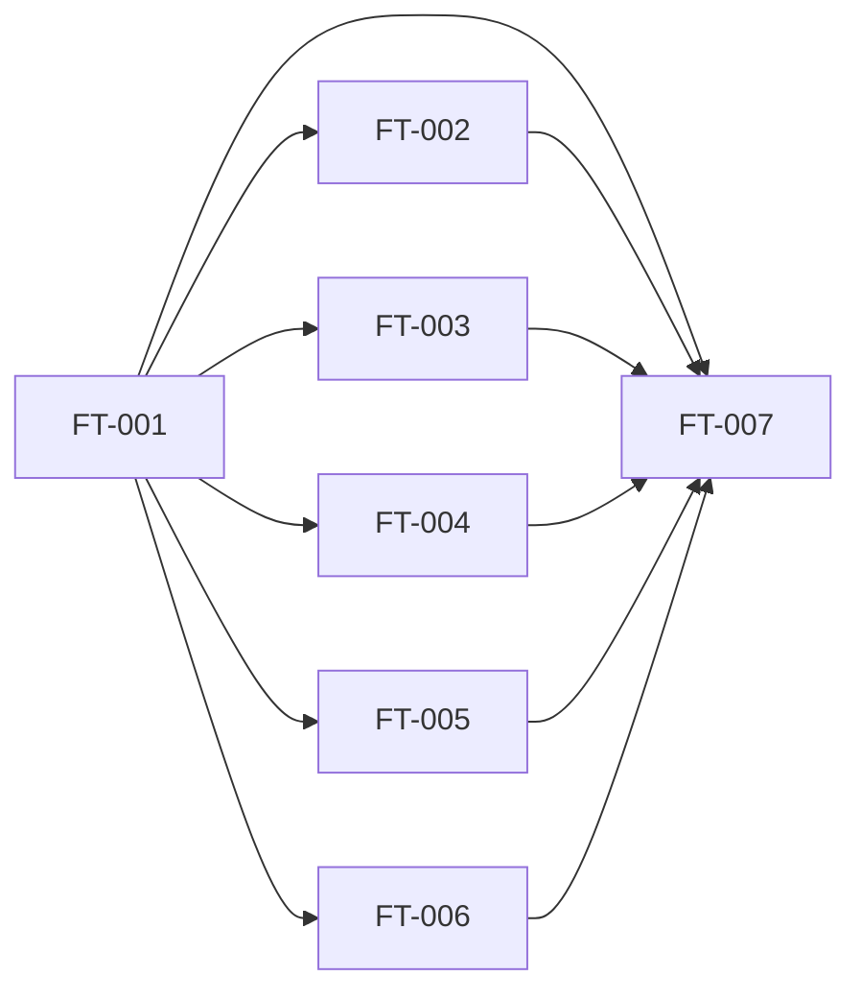

# [EP-001] Gestión del Referencial y Administración del Sistema

## Descripción

**Objetivo de negocio:** Proporcionar al [ACT-H001] Administrador las herramientas necesarias para construir y mantener el catálogo tecnológico de referencia de la Dirección Técnica, incluyendo la gestión del ciclo de vida de cada entrada, las plantillas de valoración de KPIs y la configuración del árbol de decisión que rige el semáforo de estado. Este épico constituye la fundación del sistema: sin un referencial coherente no es posible describir los aplicativos ni medir su madurez.

**Actores principales:** [ACT-H001] Administrador

**Entidades concernidas:** [ENT-004] EntradaCatalogo, [ENT-005] BloqueTematico, [ENT-007] PlantillaDeValoracion, [ENT-011] ReglaDecision

**Requisitos cubiertos:** [EX-001], [EX-002], [EX-008]

---

## Índice de funcionalidades

| ID | Nombre de la funcionalidad | Prioridad | Complejidad | Dependencias | Ruta |
|----|---------------------------|-----------|-------------|--------------|------|
| [FT-001] | Catálogo de tecnologías — gestión general | Must | Media | — | [ft-001-catalogo-tecnologias/ft-001-catalogo-tecnologias.md](ft-001-catalogo-tecnologias/ft-001-catalogo-tecnologias.md) |
| [FT-002] | Herramientas de ejecución local y stack tecnológico | Must | Baja | [FT-001] | [ft-002-herramientas-ejecucion-local/ft-002-herramientas-ejecucion-local.md](ft-002-herramientas-ejecucion-local/ft-002-herramientas-ejecucion-local.md) |
| [FT-003] | Herramientas de CI y seguridad | Must | Baja | [FT-001] | [ft-003-herramientas-ci-seguridad/ft-003-herramientas-ci-seguridad.md](ft-003-herramientas-ci-seguridad/ft-003-herramientas-ci-seguridad.md) |
| [FT-004] | Herramientas de CD, IaC e inteligencia artificial | Must | Baja | [FT-001] | [ft-004-herramientas-cd-iac-ia/ft-004-herramientas-cd-iac-ia.md](ft-004-herramientas-cd-iac-ia/ft-004-herramientas-cd-iac-ia.md) |
| [FT-005] | Entornos de infraestructura | Must | Baja | [FT-001] | [ft-005-entornos-infraestructura/ft-005-entornos-infraestructura.md](ft-005-entornos-infraestructura/ft-005-entornos-infraestructura.md) |
| [FT-006] | Plantillas de valoración de KPIs | Should | Media | [FT-001] | [ft-006-plantillas-valoracion-kpi/ft-006-plantillas-valoracion-kpi.md](ft-006-plantillas-valoracion-kpi/ft-006-plantillas-valoracion-kpi.md) |
| [FT-007] | Ciclo de vida del referencial y árbol de decisión | Must | Alta | [FT-001], [FT-002], [FT-003], [FT-004], [FT-005], [FT-006] | [ft-007-ciclo-vida-referencial/ft-007-ciclo-vida-referencial.md](ft-007-ciclo-vida-referencial/ft-007-ciclo-vida-referencial.md) |

---

## Dependencias entre funcionalidades

---

## Orden de implementación sugerido

| Orden | Funcionalidad | Justificación |
|-------|---------------|---------------|
| 1 | [FT-001] Catálogo de tecnologías — gestión general | Base estructural: define los bloques temáticos y el mecanismo CRUD genérico de entradas del catálogo |
| 2 | [FT-002] Herramientas de ejecución local y stack tecnológico | Primer bloque temático poblado; valida el flujo de creación de entradas |
| 3 | [FT-003] Herramientas de CI y seguridad | Segundo bloque; reutiliza el patrón establecido en FT-002 |
| 4 | [FT-004] Herramientas de CD, IaC e inteligencia artificial | Tercer bloque; incluye las herramientas de IA que son referenciadas por los casos de éxito |
| 5 | [FT-005] Entornos de infraestructura | Cuarto bloque; entradas con atributo TipoDeEntorno adicional |
| 6 | [FT-006] Plantillas de valoración de KPIs | Contenido guía para los Referentes DT; desbloquea la captura homogénea de KPIs |
| 7 | [FT-007] Ciclo de vida del referencial y árbol de decisión | Consolida: dar de baja / reactivar entradas y configurar las reglas de decisión |

---

## Criterios de aceptación

### EAC-001: Catálogo tecnológico operativo con todos los bloques temáticos

- **Dado** que el Administrador ha iniciado sesión en el sistema
- **Cuando** accede a la sección de gestión del catálogo tecnológico
- **Entonces** puede crear, modificar y consultar entradas en los bloques: stack tecnológico, herramientas de ejecución local, herramientas CI/Seguridad, herramientas CD/IaC/IA y entornos de infraestructura
- **Y** cada entrada muestra su nombre, bloque temático, tipo de propiedad (corporativo / proyecto / cliente) y estado (activo / dado de baja)

### EAC-002: Ciclo de vida de una entrada del catálogo — dar de baja y reactivar

- **Dado** que existe una entrada del catálogo en estado "activo" utilizada por al menos 3 aplicativos del proyecto "ProyectoAlpha"
- **Cuando** el Administrador ejecuta la acción "dar de baja" sobre esa entrada
- **Entonces** la entrada pasa al estado "dado de baja" y deja de estar disponible para nuevas asociaciones
- **Y** los aplicativos que ya la referenciaban conservan la asociación histórica sin modificación

### EAC-003: Plantillas de valoración disponibles para las 7 dimensiones de madurez

- **Dado** que el Administrador ha configurado una plantilla de valoración activa para cada una de las 7 dimensiones ([ENT-007])
- **Cuando** un Referente DT accede a la ficha de captura de KPIs de cualquier aplicativo
- **Entonces** puede consultar la plantilla activa correspondiente a cada dimensión como guía de puntuación
- **Y** el sistema garantiza que solo existe una plantilla activa por dimensión en todo momento

### EAC-004: Configuración del árbol de decisión con umbrales aplicables

- **Dado** que el Administrador configura una regla de decisión con umbral KPI < 5 para la dimensión "Industrialización" al nivel de aplicativo
- **Cuando** un Referente DT registra un KPI de Industrialización con valor 3 para el aplicativo "AppBeta"
- **Entonces** el sistema genera automáticamente un riesgo técnico de tipo "automático" sobre "AppBeta"
- **Y** el semáforo de estado del aplicativo "AppBeta" refleja el nivel de riesgo definido en la regla

### EAC-005: Integralidad del referencial — todos los bloques temáticos presentes

- **Dado** que el sistema está en producción con el catálogo tecnológico configurado
- **Cuando** un Referente DT describe el stack tecnológico de cualquier aplicativo de la DT
- **Entonces** puede encontrar en el catálogo entradas representativas de su lenguaje de programación, sus herramientas de CI, sus herramientas de CD/IaC, su entorno de infraestructura y su puesto de trabajo
- **Y** ninguna categoría técnica de los aplicativos activos de la DT queda sin entrada disponible en el referencial

---

## Definición de preparado

- [ ] Todas las funcionalidades [FT-001] a [FT-007] de este épico tienen estado `validated`
- [ ] Todos los criterios de aceptación a nivel de épico están cubiertos por escenarios E2E
- [ ] Todas las dependencias entre funcionalidades están resueltas
- [ ] No existe ningún BLOCK en los informes de validación de ninguna funcionalidad de este épico
- [ ] Las reglas de negocio referenciadas por este épico están cubiertas por escenarios de prueba

---

## Puntos de atención

| ID | Punto | Descripción |
|----|-------|-------------|
| PAT-EP001-01 | Impacto de dar de baja sobre aplicativos asociados | Cuando el Administrador da de baja una entrada del catálogo utilizada por aplicativos activos, el comportamiento esperado (notificación interna, restricción de edición, impacto en KPIs de madurez tecnológica) no está completamente especificado. Ver ESC-002 de [ACT-001] y PAT-DOM-001 de [DOM-001]. Requiere decisión de diseño antes de la especificación de FT-007. |
| PAT-EP001-02 | Umbrales concretos del árbol de decisión | Los valores numéricos de los umbrales del árbol de decisión no están predefinidos en el sistema ([VIS-001] HYP-004). El Administrador los configura en FT-007. Requiere que el Director proponga los valores iniciales antes de la puesta en marcha de la Fase 1. |

---

## Trazabilidad

| Elemento | Detalle |
|---------|--------|
| **Producido por** | agent-epics |
| **Fecha de producción** | 2026-04-29 |
| **Entradas utilizadas** | [VIS-001], [GLO-001], [ACT-001], [DOM-001], [EXF-001] |
| **Validado por** | Pendiente |
| **Fecha de validación** | Pendiente |

---

## Confianza de producción

| Dimensión | Nivel | Brechas identificadas |
|-----------|-------|-----------------------|
| Entradas suficientes | WARN | DOM-001 tiene estado `draft`. Los cinco documentos fuente son coherentes y suficientes para estructurar el épico. La brecha principal es el comportamiento de dar de baja (ESC-002) y la ausencia de valores concretos de umbrales del árbol de decisión, ambos documentados como puntos de atención. |
| Cobertura de requisitos | CONFIDENT | EX-001, EX-002 y EX-008 (parte administración) están cubiertos por las 7 funcionalidades del épico. Ningún requisito asignado queda sin funcionalidad. |
| Usabilidad por agent-features | CONFIDENT | El índice de funcionalidades, el diagrama de dependencias, el orden de implementación y los criterios de aceptación son directamente utilizables por agent-2.2b-features para producir los archivos de detalle FT-xxx. |
