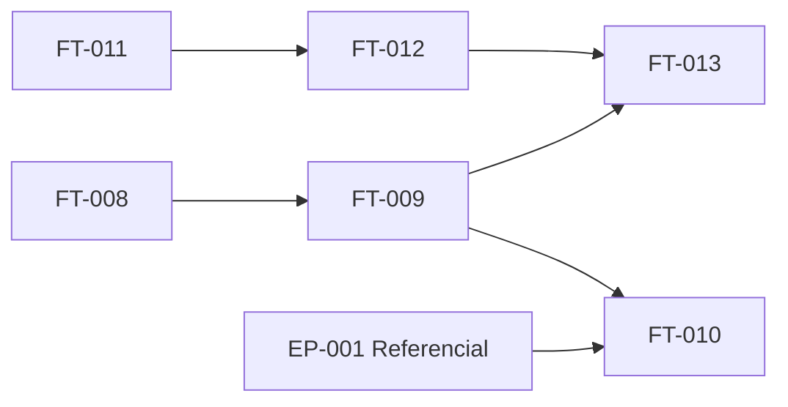

# [EP-002] Cartografía Organizativa y Gestión de Usuarios

## Descripción

**Objetivo de negocio:** Permitir al [ACT-H001] Administrador construir y mantener la estructura jerárquica Cliente > Proyecto > Aplicativo que organiza todo el porfolio de la Dirección Técnica, gestionar los usuarios y sus roles, e integrar la autenticación corporativa mediante OpenID Connect. Este épico habilita a los [ACT-H003] Managers y [ACT-H004] Referentes DT para describir técnicamente los aplicativos de sus proyectos asignados, asociándolos a las entradas del catálogo tecnológico. Sin la cartografía completa y una gestión de acceso operativa, ninguna otra funcionalidad del sistema puede ejecutarse.

**Actores principales:** [ACT-H001] Administrador, [ACT-H003] Manager, [ACT-H004] Referente DT, [ACT-S001] Servicio SSO Corporativo

**Entidades concernidas:** [ENT-001] Cliente, [ENT-002] Proyecto, [ENT-003] Aplicativo, [ENT-012] Usuario, [ENT-004] EntradaCatalogo

**Requisitos cubiertos:** [EX-003], [EX-004], [EX-005], [EX-006]

---

## Índice de funcionalidades

| ID | Nombre de la funcionalidad | Prioridad | Complejidad | Dependencias | Ruta |
|----|---------------------------|-----------|-------------|--------------|------|
| [FT-008] | Gestión de clientes | Must | Baja | — | [ft-008-gestion-clientes/ft-008-gestion-clientes.md](ft-008-gestion-clientes/ft-008-gestion-clientes.md) |
| [FT-009] | Gestión de proyectos | Must | Baja | [FT-008] | [ft-009-gestion-proyectos/ft-009-gestion-proyectos.md](ft-009-gestion-proyectos/ft-009-gestion-proyectos.md) |
| [FT-010] | Gestión de aplicativos y descripción técnica | Must | Media | [FT-009], [EP-001] | [ft-010-gestion-aplicativos/ft-010-gestion-aplicativos.md](ft-010-gestion-aplicativos/ft-010-gestion-aplicativos.md) |
| [FT-011] | Autenticación OIDC | Must | Alta | — | [ft-011-autenticacion-oidc/ft-011-autenticacion-oidc.md](ft-011-autenticacion-oidc/ft-011-autenticacion-oidc.md) |
| [FT-012] | Perfiles y roles de usuario | Must | Media | [FT-011] | [ft-012-perfiles-y-roles/ft-012-perfiles-y-roles.md](ft-012-perfiles-y-roles/ft-012-perfiles-y-roles.md) |
| [FT-013] | Asignación de usuarios a proyectos | Must | Baja | [FT-009], [FT-012] | [ft-013-asignacion-usuarios-proyectos/ft-013-asignacion-usuarios-proyectos.md](ft-013-asignacion-usuarios-proyectos/ft-013-asignacion-usuarios-proyectos.md) |

---

## Dependencias entre funcionalidades

---

## Orden de implementación sugerido

| Orden | Funcionalidad | Justificación |
|-------|---------------|---------------|
| 1 | [FT-011] Autenticación OIDC | Prerrequisito absoluto: ningún usuario puede acceder al sistema sin autenticación operativa |
| 2 | [FT-012] Perfiles y roles de usuario | Depende de FT-011; habilita la creación de usuarios con rol y el control de acceso por rol |
| 3 | [FT-008] Gestión de clientes | Primera capa de la jerarquía; base para proyectos y aplicativos |
| 4 | [FT-009] Gestión de proyectos | Segunda capa; requiere al menos un cliente creado |
| 5 | [FT-013] Asignación de usuarios a proyectos | Vincula los roles operacionales a su ámbito; desbloquea el acceso de Managers y Referentes DT |
| 6 | [FT-010] Gestión de aplicativos y descripción técnica | Tercera capa de la jerarquía; requiere proyecto, usuario asignado y referencial EP-001 operativo |

---

## Criterios de aceptación

### EAC-006: Jerarquía organizativa completa y navegable

- **Dado** que el Administrador ha creado el cliente "ClienteGamma", el proyecto "ProyectoDelta" bajo ese cliente y el aplicativo "AppEpsilon" bajo ese proyecto
- **Cuando** cualquier usuario con acceso al sistema navega desde la vista de clientes hacia los aplicativos
- **Entonces** puede recorrer la jerarquía Cliente > Proyecto > Aplicativo en ambos sentidos
- **Y** no es posible eliminar "ClienteGamma" mientras "ProyectoDelta" exista, ni "ProyectoDelta" mientras "AppEpsilon" exista

### EAC-007: Descripción técnica completa de un aplicativo

- **Dado** que el catálogo tecnológico de EP-001 contiene entradas activas en todos los bloques temáticos
- **Cuando** el Referente DT "referente01@dt.es" describe el aplicativo "AppZeta" de su proyecto asignado
- **Entonces** puede asociar entradas del catálogo para definir el stack tecnológico, las herramientas CI/Seguridad, las herramientas CD/IaC/IA, los entornos de infraestructura y el puesto de trabajo del equipo
- **Y** al guardar la asociación, el sistema genera automáticamente los 7 registros KPIDeMadurez con valor nulo para "AppZeta"

### EAC-008: Autenticación corporativa funcional en todos los entornos

- **Dado** que el sistema está configurado con Keycloak en el entorno de desarrollo y Active Directory Corporativo Azure en cualificación y producción
- **Cuando** el usuario "manager01@dt.es" intenta iniciar sesión en cualquier entorno
- **Entonces** el sistema redirige la autenticación al proveedor de identidad correspondiente al entorno activo sin cambios de código
- **Y** el acceso se concede únicamente si el usuario está registrado en el sistema con un rol activo ([ENT-012])

### EAC-009: Control de acceso por rol y ámbito de proyecto

- **Dado** que el Referente DT "referente01@dt.es" está asignado únicamente al proyecto "ProyectoAlpha"
- **Cuando** intenta crear un aplicativo en el proyecto "ProyectoBeta" (no asignado) y modificar un aplicativo en "ProyectoAlpha"
- **Entonces** la creación en "ProyectoBeta" es rechazada con mensaje de acceso denegado
- **Y** la modificación en "ProyectoAlpha" se ejecuta correctamente

### EAC-010: Gestión del ciclo de vida de usuarios por el Administrador

- **Dado** que el Administrador registra al nuevo usuario "referente02@dt.es" con rol ROL_REFERENTE y lo asigna al proyecto "ProyectoAlpha"
- **Cuando** "referente02@dt.es" inicia sesión y accede al sistema
- **Entonces** puede crear y editar aplicativos únicamente en "ProyectoAlpha" y tiene lectura sobre todos los proyectos del sistema
- **Y** si el Administrador desactiva la cuenta, "referente02@dt.es" pierde el acceso mientras sus registros y asignaciones se conservan intactos

---

## Definición de preparado

- [ ] Todas las funcionalidades [FT-008] a [FT-013] de este épico tienen estado `validated`
- [ ] Todos los criterios de aceptación a nivel de épico están cubiertos por escenarios E2E
- [ ] Todas las dependencias entre funcionalidades están resueltas
- [ ] No existe ningún BLOCK en los informes de validación de ninguna funcionalidad de este épico
- [ ] Las reglas de negocio referenciadas por este épico están cubiertas por escenarios de prueba

---

## Puntos de atención

| ID | Punto | Descripción |
|----|-------|-------------|
| PAT-EP002-01 | Viabilidad de la integración SSO en el plazo de Fase 0 | HYP-001 de [VIS-001] está resuelta (OIDC confirmado), pero la viabilidad técnica de la integración con AD Corporativo Azure en el plazo comprometido requiere confirmación del equipo técnico antes del diseño de FT-011. Ver PAT-001 de [ACT-001]. |
| PAT-EP002-02 | Capacidad del Manager para editar metadatos del proyecto | Solo se ha asignado lectura sobre proyectos al ROL_MANAGER de forma conservadora. PAT-002 de [ACT-001] indica que esta decisión requiere validación del sponsor antes de la especificación de FT-009. |
| PAT-EP002-03 | Carga inicial de los aplicativos existentes | El proceso de migración de los cientos de aplicativos ya gestionados por la DT (scripts SQL/Liquibase u otro mecanismo) no está definido. Ver OUT-005 de [VIS-001]. Debe coordinarse con el equipo técnico antes del arranque de la Fase 0. |

---

## Trazabilidad

| Elemento | Detalle |
|---------|--------|
| **Producido por** | agent-epics |
| **Fecha de producción** | 2026-04-29 |
| **Entradas utilizadas** | [VIS-001], [GLO-001], [ACT-001], [DOM-001], [EXF-001] |
| **Validado por** | Pendiente |
| **Fecha de validación** | Pendiente |

---

## Confianza de producción

| Dimensión | Nivel | Brechas identificadas |
|-----------|-------|-----------------------|
| Entradas suficientes | WARN | DOM-001 tiene estado `draft`. El contenido de los cinco documentos fuente es coherente y suficiente para estructurar el épico. La brecha principal es la viabilidad SSO (PAT-EP002-01) y los metadatos de proyecto editables por Manager (PAT-EP002-02), ambos documentados. |
| Cobertura de requisitos | CONFIDENT | EX-003, EX-004, EX-005 y EX-006 están completamente cubiertos por las 6 funcionalidades del épico. Todos los actores (Administrador, Manager, Referente DT, SSO) tienen al menos una funcionalidad asignada. |
| Usabilidad por agent-features | CONFIDENT | El índice de funcionalidades, el diagrama de dependencias, el orden de implementación y los criterios de aceptación son directamente utilizables por agent-2.2b-features para producir los archivos de detalle FT-xxx. |
