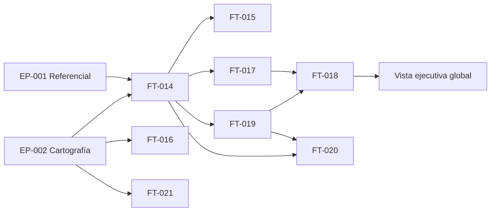

# [EP-003] Madurez Técnica, Visualización y Gestión de Riesgos

## Descripción

**Objetivo de negocio:** Dotar a la Dirección Técnica de los instrumentos para medir la madurez técnica de sus aplicativos, agregar esa información en vistas ejecutivas con semáforo de estado, detectar y gestionar riesgos técnicos de forma proactiva, y visibilizar la adopción de la inteligencia artificial. Este épico corresponde a la Fase 1 del proyecto y opera sobre la cartografía establecida en EP-002 y el referencial de EP-001. Sus funcionalidades transforman los datos de los aplicativos en información de valor para la toma de decisiones estratégicas del [ACT-H002] Director y operativas del [ACT-H003] Manager.

**Actores principales:** [ACT-H001] Administrador, [ACT-H002] Director, [ACT-H003] Manager, [ACT-H004] Referente DT

**Entidades concernidas:** [ENT-006] KPIDeMadurez, [ENT-007] PlantillaDeValoracion, [ENT-011] ReglaDecision, [ENT-008] RiesgoTecnico, [ENT-009] PlanDeAccion, [ENT-010] CasoDeExitoIA, [ENT-003] Aplicativo, [ENT-002] Proyecto

**Requisitos cubiertos:** [EX-007], [EX-008], [EX-009], [EX-010], [EX-011], [EX-012], [EX-013], [EX-014], [EX-015]

---

## Índice de funcionalidades

| ID | Nombre de la funcionalidad | Prioridad | Complejidad | Dependencias | Ruta |
|----|---------------------------|-----------|-------------|--------------|------|
| [FT-014] | Captura de KPIs de madurez | Must | Media | EP-002, EP-001 [FT-006] | [ft-014-captura-kpis-madurez/ft-014-captura-kpis-madurez.md](ft-014-captura-kpis-madurez/ft-014-captura-kpis-madurez.md) |
| [FT-015] | Consulta del histórico de evaluaciones de KPIs | Should | Baja | [FT-014] | [ft-015-historico-kpis/ft-015-historico-kpis.md](ft-015-historico-kpis/ft-015-historico-kpis.md) |
| [FT-016] | Registro y gestión de casos de éxito de IA | Should | Media | EP-002 | [ft-016-casos-exito-ia/ft-016-casos-exito-ia.md](ft-016-casos-exito-ia/ft-016-casos-exito-ia.md) |
| [FT-017] | Vista de madurez por aplicativo (radar) | Must | Media | [FT-014] | [ft-017-vista-aplicativo-radar/ft-017-vista-aplicativo-radar.md](ft-017-vista-aplicativo-radar/ft-017-vista-aplicativo-radar.md) |
| [FT-018] | Vistas agregadas con semáforo por proyecto y cliente | Must | Alta | [FT-017], [FT-019] | [ft-018-vistas-agregadas-semaforo/ft-018-vistas-agregadas-semaforo.md](ft-018-vistas-agregadas-semaforo/ft-018-vistas-agregadas-semaforo.md) |
| [FT-019] | Árbol de decisión y semáforo de estado | Must | Alta | [FT-014] | [ft-019-arbol-decision-semaforo/ft-019-arbol-decision-semaforo.md](ft-019-arbol-decision-semaforo/ft-019-arbol-decision-semaforo.md) |
| [FT-020] | Detección automática de riesgos técnicos por KPI | Must | Alta | [FT-019], [FT-014] | [ft-020-riesgos-automaticos-kpi/ft-020-riesgos-automaticos-kpi.md](ft-020-riesgos-automaticos-kpi/ft-020-riesgos-automaticos-kpi.md) |
| [FT-021] | Registro manual de riesgos técnicos y planes de acción | Should | Media | EP-002 | [ft-021-riesgos-manuales/ft-021-riesgos-manuales.md](ft-021-riesgos-manuales/ft-021-riesgos-manuales.md) |

---

## Dependencias entre funcionalidades

---

## Orden de implementación sugerido

| Orden | Funcionalidad | Justificación |
|-------|---------------|---------------|
| 1 | [FT-014] Captura de KPIs de madurez | Fuente de verdad primaria: todos los demás cálculos y visualizaciones dependen de los KPIs registrados |
| 2 | [FT-019] Árbol de decisión y semáforo de estado | Define las reglas que transforman los KPIs en semáforos; prerrequisito para riesgos automáticos y vistas agregadas |
| 3 | [FT-017] Vista de madurez por aplicativo (radar) | Primera visualización de valor; valida la captura de KPIs con una representación gráfica directa |
| 4 | [FT-020] Detección automática de riesgos técnicos por KPI | Valor añadido inmediato sobre los KPIs capturados; requiere árbol de decisión activo |
| 5 | [FT-018] Vistas agregadas con semáforo por proyecto y cliente | Consolida la visión ejecutiva; requiere radar por aplicativo y árbol de decisión |
| 6 | [FT-021] Registro manual de riesgos técnicos y planes de acción | Complemento de la detección automática; desbloquea la gestión proactiva por el Manager |
| 7 | [FT-016] Registro y gestión de casos de éxito de IA | Funcionalidad independiente de la cadena de madurez; puede desarrollarse en paralelo |
| 8 | [FT-015] Consulta del histórico de evaluaciones de KPIs | Funcionalidad de trazabilidad; añade contexto sin bloquear las funcionalidades principales |

---

## Criterios de aceptación

### EAC-011: Captura completa de los 7 KPIs de madurez por aplicativo

- **Dado** que el aplicativo "AppZeta" existe en el proyecto "ProyectoAlpha" asignado al Referente DT "referente01@dt.es"
- **Cuando** "referente01@dt.es" accede a la ficha de KPIs de "AppZeta" y registra un valor de 7 para la dimensión "Industrialización" con justificación "Pipeline activo con Quality Gate verde" y fecha de evaluación 2026-04-29
- **Entonces** el sistema guarda el KPI con los tres campos obligatorios y muestra la plantilla de valoración activa como referencia
- **Y** el KPI queda disponible de inmediato para la generación del radar y el cálculo del semáforo

### EAC-012: Radar de madurez técnica refleja las 7 dimensiones evaluadas

- **Dado** que el aplicativo "AppZeta" tiene los 7 KPIs registrados con valores entre 3 y 9 según la dimensión
- **Cuando** cualquier usuario con acceso al sistema consulta la ficha de "AppZeta"
- **Entonces** el sistema muestra un diagrama de radar con los 7 vértices, cada uno en su posición proporcional al valor del KPI (escala 1-10)
- **Y** el radar incluye el valor numérico, la fecha de última evaluación y la justificación de cada dimensión

### EAC-013: Semáforo de estado calculado correctamente por el árbol de decisión

- **Dado** que el Administrador ha configurado la regla: "si más del 30 % de los aplicativos de un proyecto tienen KPI medio < 5, semáforo = ROJO"
- **Cuando** en el proyecto "ProyectoAlpha" de 10 aplicativos, 4 tienen al menos un KPI con valor 3 en la dimensión "Testing"
- **Entonces** el semáforo de "ProyectoAlpha" muestra color ROJO en la vista agregada
- **Y** el sistema genera automáticamente un riesgo técnico de tipo "automático" para cada aplicativo cuyo KPI de Testing está por debajo del umbral configurado

### EAC-014: Vista ejecutiva global operativa para el Director

- **Dado** que el sistema tiene datos de KPIs registrados para al menos 3 clientes con sus proyectos y aplicativos
- **Cuando** el Director [ACT-H002] accede a la vista global del porfolio
- **Entonces** ve todos los clientes con su semáforo de estado, la lista de proyectos con riesgos técnicos activos y los indicadores de adopción de herramientas de IA por proyecto
- **Y** el tiempo de carga de la vista global no supera 5 segundos con el volumen máximo previsto ([EX-T002])

### EAC-015: Gestión completa del ciclo de vida de un riesgo técnico manual

- **Dado** que el Manager "manager01@dt.es" identifica un riesgo de rotación de equipo en el proyecto "ProyectoBeta"
- **Cuando** registra manualmente el riesgo técnico con título "Riesgo de pérdida de conocimiento técnico" y asocia un plan de acción con responsable "manager01@dt.es", plazo 2026-06-30 y descripción "Documentar la arquitectura en Confluence"
- **Entonces** el riesgo queda visible con estado "Abierto" en la ficha del proyecto y en la vista del Director
- **Y** cuando el plan de acción pasa a "Completado", el Manager puede cerrar el riesgo registrando la fecha de cierre

---

## Definición de preparado

- [ ] Todas las funcionalidades [FT-014] a [FT-021] de este épico tienen estado `validated`
- [ ] Todos los criterios de aceptación a nivel de épico están cubiertos por escenarios E2E
- [ ] Todas las dependencias entre funcionalidades están resueltas
- [ ] No existe ningún BLOCK en los informes de validación de ninguna funcionalidad de este épico
- [ ] Las reglas de negocio referenciadas por este épico están cubiertas por escenarios de prueba

---

## Puntos de atención

| ID | Punto | Descripción |
|----|-------|-------------|
| PAT-EP003-01 | Ausencia de histórico de KPIs en el MVP | El MVP solo almacena el valor actual de cada KPI por aplicativo y dimensión. FT-015 se limita a mostrar la fecha y justificación del valor actual; el historial de versiones de KPIs se incorporará en Fase 2. Ver ATT-004 de [VIS-001] y PAT-DOM-004 de [DOM-001]. |
| PAT-EP003-02 | Umbrales del árbol de decisión no predefinidos | Los valores numéricos iniciales de los umbrales del árbol de decisión deben ser propuestos por el Director y configurados por el Administrador antes del inicio de la Fase 1. Sin umbrales configurados, FT-019, FT-020 y el semáforo de FT-018 no pueden generar resultados. Ver PAT-EP001-02. |
| PAT-EP003-03 | Granularidad del árbol de decisión | El modelo actual de ReglaDecision soporta condiciones con un umbral simple por dimensión. Las condiciones combinadas (p. ej., "KPI_A < 5 Y KPI_B < 7 simultáneamente") requieren una extensión del modelo de expresión. Ver PAT-DOM-003 de [DOM-001]. Impacta al diseño de FT-019. |
| PAT-EP003-04 | Flujo de validación de casos de éxito de IA simplificado | VIS-001 ATT-006 confirma que no hay flujo de aprobación en el MVP. FT-016 implementa el registro directo sin estados de validación. EX-010 (Should) queda fuera del MVP. |

---

## Trazabilidad

| Elemento | Detalle |
|---------|--------|
| **Producido por** | agent-epics |
| **Fecha de producción** | 2026-04-29 |
| **Entradas utilizadas** | [VIS-001], [GLO-001], [ACT-001], [DOM-001], [EXF-001] |
| **Validado por** | ba-validate (PASS — VAL-EP-003) |
| **Fecha de validación** | 2026-04-29 |

---

## Confianza de producción

| Dimensión | Nivel | Brechas identificadas |
|-----------|-------|-----------------------|
| Entradas suficientes | WARN | DOM-001 tiene estado `draft`. Los cinco documentos fuente son coherentes y suficientes. Las brechas principales son los umbrales del árbol de decisión (valores no definidos) y la granularidad de ReglaDecision, ambas documentadas como puntos de atención. |
| Cobertura de requisitos | CONFIDENT | EX-007 a EX-015 están cubiertos por las 8 funcionalidades del épico. EX-010 (Should — flujo de validación de casos de éxito de IA) está explícitamente fuera del MVP según VIS-001 ATT-006 y queda documentado en PAT-EP003-04. Todos los actores tienen funcionalidades asignadas. |
| Usabilidad por agent-features | CONFIDENT | El índice de funcionalidades, el diagrama de dependencias, el orden de implementación y los criterios de aceptación son directamente utilizables por agent-2.2b-features para producir los archivos de detalle FT-xxx. |
